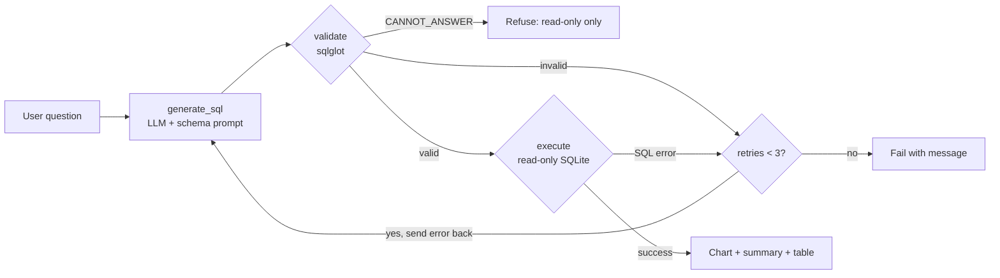

# 📊 Text-to-SQL Analytics Agent

Ask questions about a database in plain English. The agent writes the SQL, validates it for safety, runs it, **self-corrects on errors**, and returns a chart plus a plain-language summary.

Built with **LangGraph**, **Groq (LLM)**, **sqlglot**, **Streamlit**, and **Plotly**, on the Chinook music-store database.


## How it works



## Safety: 3 layers

1. **Read-only DB connection** (`mode=ro`): writes are impossible at the database level.
2. **SQL validation with sqlglot**: single statement only, `SELECT` only, no DROP/DELETE/UPDATE/INSERT/ALTER, table allowlist, auto `LIMIT 100`.
3. **Explicit refusal path**: unsafe or unanswerable requests ("Delete all customers...") return a clear refusal instead of being silently rewritten into a different query.

## Features

- Schema-aware prompting (columns, foreign keys, sample rows)
- Self-correcting loop: failed queries are sent back to the LLM with the error (max 3 retries)
- Auto chart selection based on result shape (line for time series, bar for categories)
- Plain-language summary of results
- Evaluation harness with execution-accuracy scoring

## Evaluation

20-question custom test set (5 easy, 7 medium, 6 hard, 2 must-refuse). A query counts as correct if its **result** matches the gold SQL's result (execution accuracy; column names and aliases ignored).

| Category | Score |
|---|---|
| Answerable questions | 18 / 18 |
| Unsafe requests refused | 2 / 2 |

**Caveat:** the test set is small and uses a well-known dataset, so treat this as a baseline, not a benchmark. Harder questions (ambiguous wording, window functions, multi-step reasoning) are the next addition.

Run it yourself: `python evaluate.py`

## Run locally

```bash
git clone https://github.com/chinnu-1452/text2sql-agent.git
cd text2sql-agent
python -m venv venv
venv\Scripts\activate          # Mac/Linux: source venv/bin/activate
pip install -r requirements.txt
```

Create a `.env` file with your Groq key (get one at console.groq.com):

```
GROQ_API_KEY=your_key_here
```

Then:

```bash
streamlit run app.py     # web UI
python evaluate.py       # accuracy test
```

The Chinook database downloads automatically on first run.

## Project structure

```
├── app.py          # Streamlit UI, chart selection, summary
├── graph.py        # LangGraph agent (generate -> validate -> execute)
├── generator.py    # Groq LLM prompt + SQL generation
├── validator.py    # sqlglot safety checks
├── db.py           # DB download, read-only connection, schema extractor
├── testset.py      # 20-question test set with gold SQL
├── evaluate.py     # Execution-accuracy evaluation
└── requirements.txt
```

## Limitations and next steps

- Single database (SQLite / Chinook); no multi-database support yet
- Result summaries are generated by an LLM from the first 20 rows only
- Expand the test set with harder and ambiguous questions
- Refactor the DB layer into an MCP server so other AI clients can reuse it

## Tech stack

Python · LangGraph · LangChain-Groq · sqlglot · SQLite · Pandas · Plotly · Streamlit
